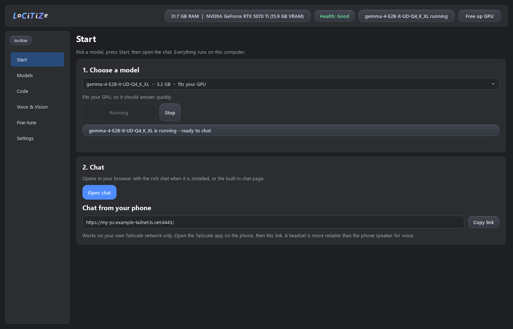
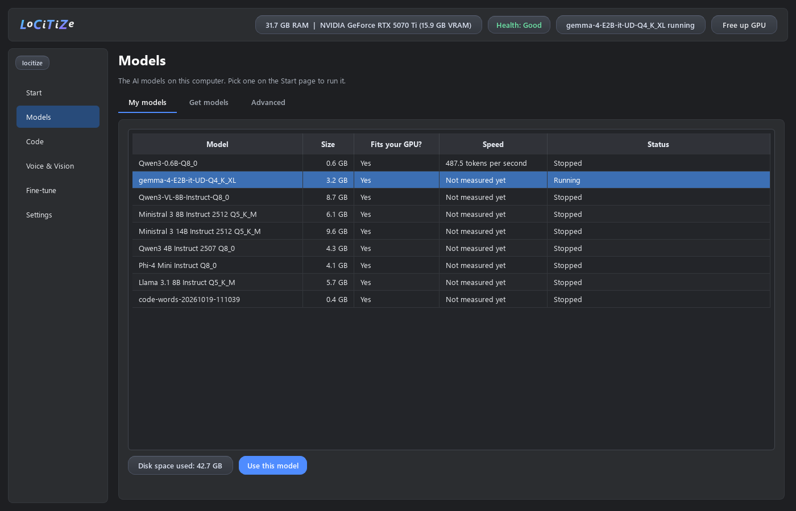
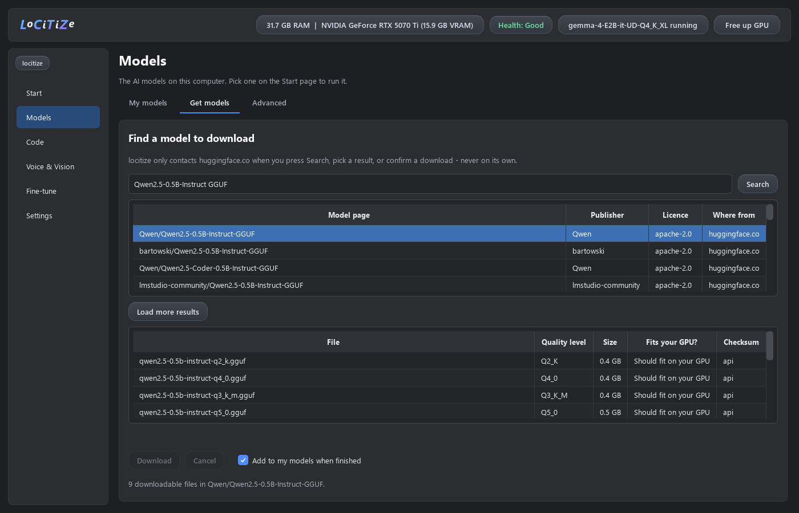
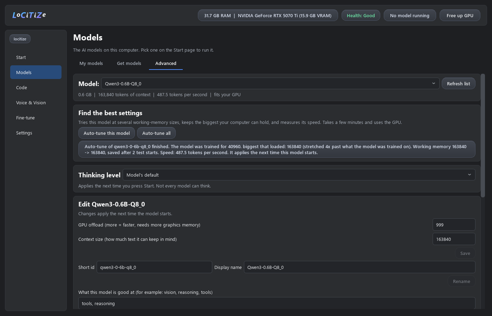
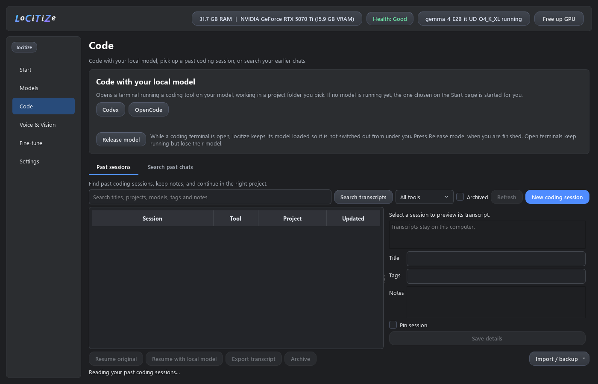
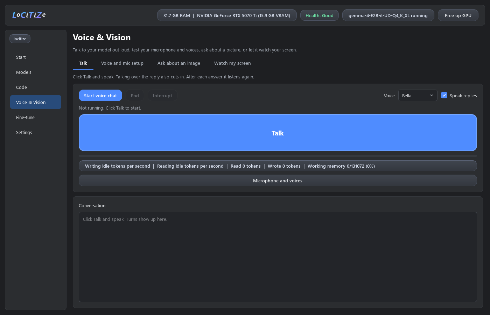
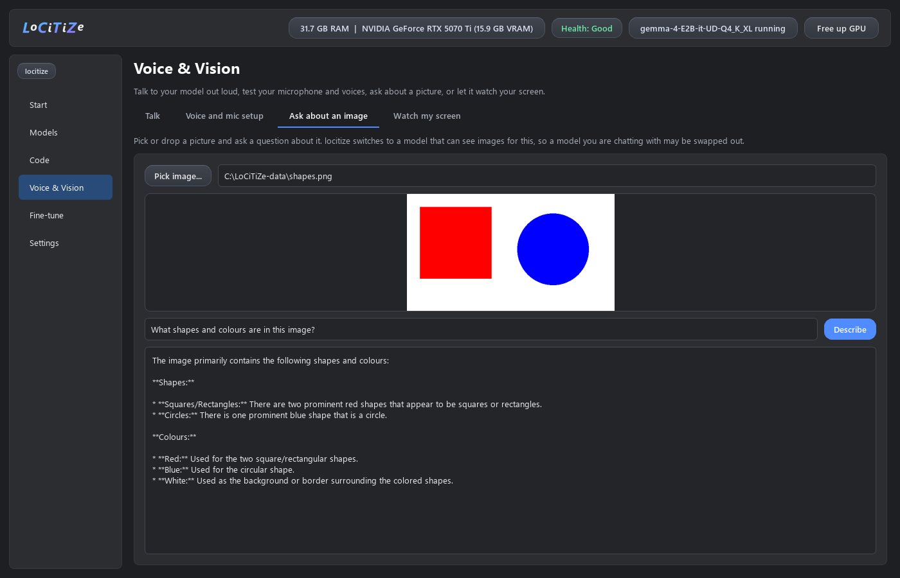
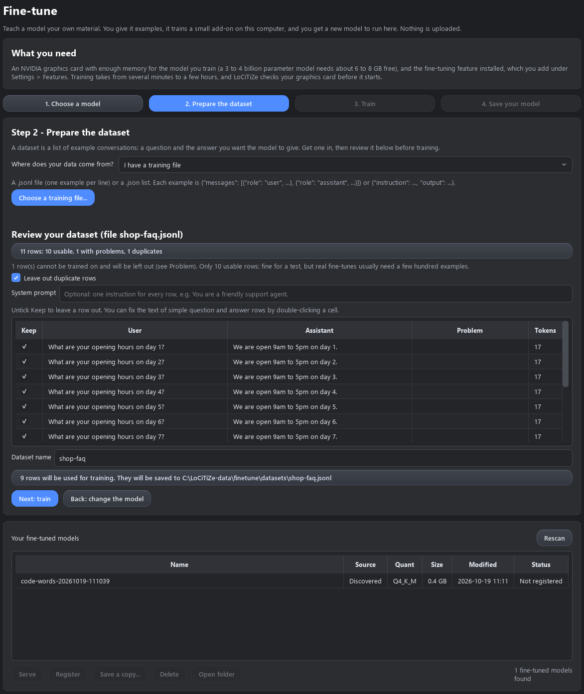
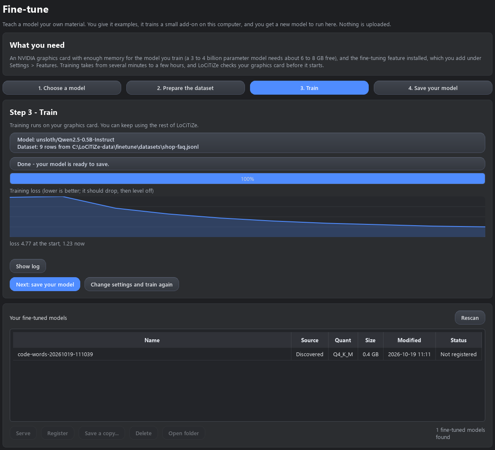
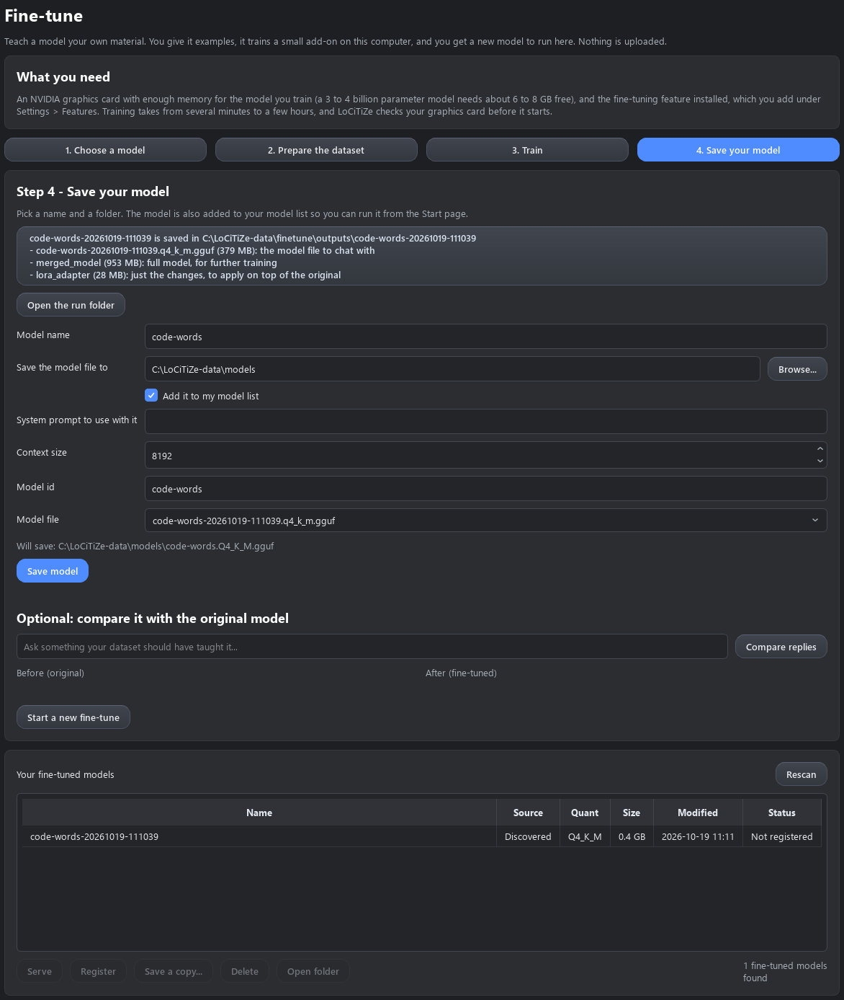

# locitize

Run local AI and continue your coding work from one Windows desktop.

locitize runs the GGUF models already on your PC and puts everything around them in one
app: chat, coding sessions, voice, vision and fine-tuning. Nothing leaves your computer
unless you ask it to.



## Install in 3 steps

1. **Download** `locitize-1.1.0-windows.zip` from the
   [latest release](https://github.com/locitize/locitize/releases/latest) and
   extract it to a folder. Python is included - nothing else to install first.
2. **Double-click `Install locitize.bat`.** It checks every file, installs under
   your user account (no admin needed) and adds Desktop and Start menu shortcuts.
3. **Open locitize.** The setup window finds the AI models already on your PC and
   installs what you pick (Open WebUI chat is ticked by default). Then, on the
   **Start** page, pick a model, press **Start**, and **Open chat**.

No models are included: locitize uses the GGUF models already on your PC (from
LM Studio, Ollama, your Downloads folder...). Have none? Open **Models > Get
models**, search for one that fits your GPU (a 4B-8B model is a good start), and
download it there.

**Good to know**
- Windows 10/11, 64-bit. An NVIDIA GPU is optional but makes everything faster.
- The download is unsigned, so Windows may show "Windows protected your PC" the
  first time: click **More info**, then **Run anyway**.
- Setup needs internet for the components you choose (a few minutes).
- Fine-tuning needs an NVIDIA GPU (8 GB or more; no Docker) and ticking
  "Fine-tune models" in setup, which downloads about 4 GB of PyTorch and training tools.

Prefer git? `git clone https://github.com/locitize/locitize`, install
[Python 3.11+](https://www.python.org/downloads/), then double-click
`platform\locitize.vbs`.

## A tour of the app

Six pages, in the order you will use them.

**Start** - pick a model (it tells you whether it fits your GPU), press Start, open the
chat in your browser. With Tailscale, the same chat opens on your phone.

**Models** - everything on your PC with its size, whether it fits your GPU and how fast it
runs. **Get models** searches Hugging Face, shows which files fit your GPU, and verifies the
download. **Advanced** auto-tunes a model: it finds the biggest working memory your PC can
really hold and measures its speed.





**Code** - open Codex or OpenCode in a terminal, working on your local model, in a project
folder you pick. **Past sessions** finds your local coding histories (Codex, OpenCode,
Gemini, Qwen, Copilot, Grok) so you can search them, add notes, and continue with your local
model or the original backend. **Search past chats** searches your earlier conversations.



**Voice & Vision** - **Talk** to your model out loud, set up the microphone and pick a
voice, **ask about an image**, or let it **watch your screen** and speak up when you drift
from a goal you type.




**Fine-tune** - teach a model your own material in four steps:

1. **Choose a model** - LoCiTiZe checks it fits your graphics card.
2. **Prepare the dataset** - from a training file, your documents, a word table, or a
   bigger model writing the answers. Then review every row: rows the trainer cannot use are
   flagged, duplicates are dropped, and you can untick or fix any row.
3. **Train** - on your own GPU, with progress and the training loss as it drops.
4. **Save your model** - to a folder you pick, added to your model list in one click.





**Settings** - what is installed (add anything missing with setup), coding tools, phone
access, microphone noise cleanup, and About and diagnostics.

Local coding launches use process-specific settings. They do not rewrite the
tools' global configuration or disable their permission prompts. Open WebUI's
request-selected model remains authoritative unless a coding session has reserved
the running model. **Release model** on the Code page lets the model switch again once
you have finished in the coding terminals.

## Session migration and data

Code > Past sessions > Import / backup > Import Session Portal details imports titles,
notes, tags, pins, and archived state from a selected legacy data folder.
Ambiguous cross-provider identities are skipped. Original histories and legacy
files are preserved. Annotation imports keep existing locitize edits.

Session backups contain locitize annotations; they do not back up the original
tools' transcripts. Exported transcripts can contain sensitive information.
locitize does not upload session histories during discovery or search.

Fresh installs use %LOCALAPPDATA%\locitize. LOCITIZE_DATA_DIR overrides this;
source checkouts also recognize platform/locitize-data. Packaged optional Python
environments live in the data directory, separated by release version.

Updates install side by side and redirect shortcuts. To roll back, open the
previous version's locitize.exe. Remove an old version's installation directory
only after closing it; your data directory is separate. This beta does not yet
provide a registered Windows uninstaller or automatic updates.

## Develop and verify

From the repository root in PowerShell:

```powershell
python -m venv .venv
.venv\Scripts\python -m pip install -r platform/requirements-core.lock -r platform/requirements-dev.txt
.venv\Scripts\python platform/launcher.py --health --json
Set-Location platform
..\.venv\Scripts\python -m pytest -q
```

The optional full voice stack remains in platform/requirements.txt.
Source desktop entry: platform\locitize.vbs.
Release build: run platform\scripts\build_release.py using the prepared venv on
Windows; see [release instructions](platform/docs/release-readiness.md).
New source modules must be tracked before building, because the package uses
Git's tracked file list.

See [architecture](platform/docs/architecture.md),
[security boundaries](SECURITY.md), and [third-party notices](THIRD_PARTY.md).
